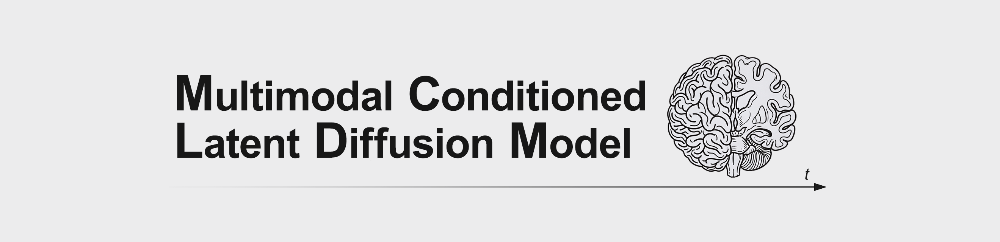
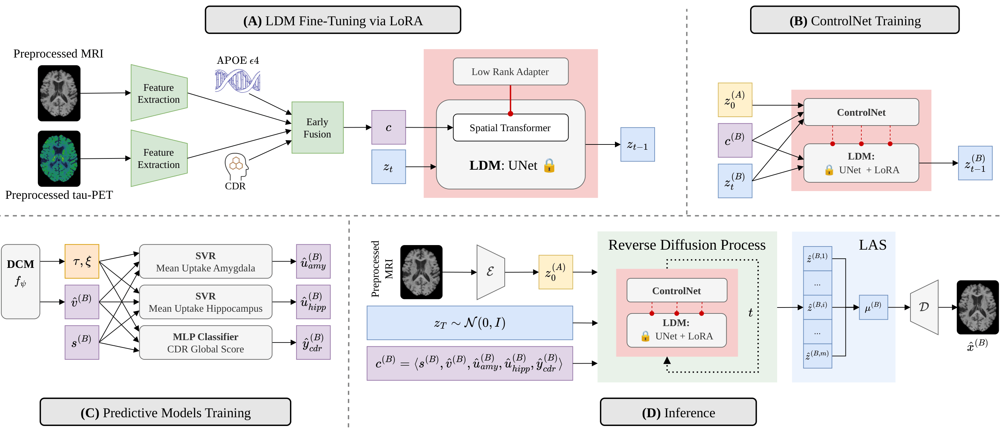

<p align="center">
    <strong>Multimodal-Conditioned Latent Diffusion Models for Spatiotemporal Brain MRI Forecasting</strong><br/>
    <a href="https://scholar.google.com/citations?user=VNQ6auUAAAAJ">Antonio Scardace</a>,
    <a href="https://scholar.google.com/citations?user=b9J6OG8AAAAJ">Silvia Ingala</a>,
    <a href="https://scholar.google.com/citations?user=OplbtHgAAAAJ">Sebastiano Battiato</a>, and
    <a href="https://scholar.google.com/citations?user=qh2Rr-cAAAAJ">Daniele Ravì</a>
</p>

<div align="center">
    <a href="https://img.shields.io/badge/Python-3.9+-blue?style=for-the-badge" alt="Python"></a>
    <a href="https://arxiv.org/abs/2610.25481"></a>
    <a href="https://github.com/antonioscardace/MC-LDM/blob/master/LICENSE"></a>
</div>
<br/>

Forecasting how a patient’s brain will change is central to monitoring Alzheimer’s disease, yet informative biomarkers such as tau-PET and clinical scores are rarely available in routine care. Building on [BrLP](https://github.com/LemuelPuglisi/BrLP), **MC-LDM** extends latent diffusion-based MRI forecasting with multimodal conditioning. By leveraging tau-PET, CDR, and APOE $\varepsilon4$ during training, it generates personalized MRI forecasts without requiring PET or clinical assessments at inference, improving regional volumetric accuracy over the compared baselines.

## Installation

We recommend using a dedicated virtual environment, such as [Anaconda](https://www.anaconda.com/), to avoid dependency conflicts. <br/>
The code has been tested with Python 3.9, but it is expected to work with newer versions as well.<br/>
Clone the repository and install the package in editable mode:

```console
git clone https://github.com/antonioscardace/MC-LDM.git
cd MC-LDM/
pip install -e .
```

## Training

<p align="center">
    
</p>

Training MC-LDM proceeds in three sequential stages: **(A)** fine-tuning the LDM via LoRA; **(B)** training ControlNet with the autoencoder, UNet, and LoRA weights frozen; and **(C)** fitting the auxiliary biomarker predictors. Train the model on your own multimodal dataset using the commands below, and monitor training progress with `Weights & Biases (W&B)`. The pre-trained BrLP models are available [here](https://github.com/LemuelPuglisi/BrLP).

```console
python scripts/train_diffusion_lora.py \
  --dataset_csv data/dataset.csv \
  --exp_name EXP_NAME \
  [OPTIONS]
```

```console
python scripts/train_controlnet.py \
  --dataset_csv data/dataset.csv \
  --lora_ckpt models/lora.pth \
  --exp_name EXP_NAME \
  [OPTIONS]
```

```console
python scripts/train_predictors.py \
  --dataset_csv data/dataset.csv \
  --output_dir models/ \
  [OPTIONS]
```

## Usage

To execute the standalone inference pipeline for the MC-LDM pipeline, run the following command. This script predicts the future MRI of a single patient at a specified target age based on their clinical history and saves the predicted scan as a NIfTI file (3D volume).

Please, remember that this software is intended for research purposes only. It is not a medical device and must not be used for diagnosis, prognosis, or any clinical decision-making.

```console
python scripts/predict.py \
  --subject_csv history.csv \
  --output_path results/ \
  --lora_ckpt models/lora.pth \
  --cnet_ckpt models/controlnet.pth \
  --svr_amygdala models/svr_amygdala_mean_uptake.pkl \
  --svr_hippocampus models/svr_hippocampus_mean_uptake.pkl \
  --mlp_cdr models/mlp_cdr_global.pkl
  --target_age 85 \
  --m 8
```

## Citation

arXiv Preprint:

```bib
@misc{scardace2026mcldm,
    title={Multimodal-Conditioned Latent Diffusion Models for Spatiotemporal Brain MRI Forecasting}, 
    author={Antonio Scardace and Silvia Ingala and Sebastiano Battiato and Daniele Ravì},
    year={2026},
    eprint={2610.25481},
    archivePrefix={arXiv},
    url={https://arxiv.org/abs/2610.25481}
}
```
